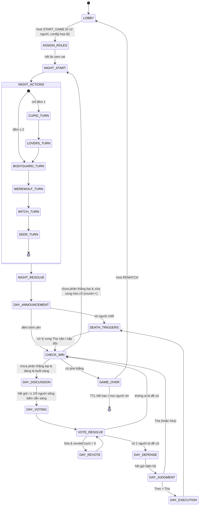

# 🐺 Ma Sói — Giai đoạn 1: Kiến trúc Dữ liệu, State Machine & Data Masking

> 📜 **Luật chơi chi tiết:** xem [RULEBOOK.md](./RULEBOOK.md) — tổng hợp từ bài viết Lens Xoắn và PDF Ultimate Werewolf. Tài liệu này mô tả cách engine hiện thực các luật đó.

> **Tech stack đã chốt (đề xuất):**
> Backend **NestJS (TypeScript)** · Realtime **Socket.io + @socket.io/redis-adapter** · **Redis 7** (state, lock, TTL, pub/sub) · **PostgreSQL + Prisma** (user, lịch sử, thành tích) · Frontend **Next.js + Zustand** · Monorepo **pnpm workspaces** với package `@werewolf/shared` dùng chung type + Zod schema giữa client và server.

---

## 1. Finite State Machine (FSM)

### 1.1 Sơ đồ tổng thể



> `CHECK_WIN` là **pha tức thì** (server-only). Engine nhớ `afterCheckWin: 'DAY' | 'NIGHT'` để biết đi tiếp đâu.

### 1.2 Bảng chuyển trạng thái (Transition Table)

| Phase | Thời lượng mặc định | Trigger thoát | Guard | Side-effect khi ENTER |
|---|---|---|---|---|
| `LOBBY` | ∞ (TTL phòng 30') | `game:start` từ host | 6 ≤ n ≤ 12, `roleConfig` hợp lệ (RULEBOOK §5) | — |
| `ASSIGN_ROLES` | 8s | timer | — | Shuffle bằng `crypto.randomInt` (Fisher-Yates), xáo ghế, gửi `role:assigned` riêng từng socket, join sói vào kênh `wolves` |
| `NIGHT_START` | 3s | timer | — | Khóa chat chung, bật wolf-chat (và lovers-chat) |
| `CUPID_TURN` | 20s **cố định**, chỉ đêm 1 | timer | — | Hỏi Cupid chọn 2 người; hết giờ ⇒ ghép ngẫu nhiên |
| `LOVERS_TURN` | 8s cố định, chỉ đêm 1 | timer | — | Gửi `lovers:paired` cho 2 người yêu; luôn chạy kể cả khi ván không có Cupid |
| `BODYGUARD_TURN` | 15s **cố định** | timer *(submit sớm vẫn chờ hết giờ)* | — | `action:request` cho Bảo vệ còn sống |
| `WEREWOLF_TURN` | 30s cố định | timer | — | `action:request` cho sói |
| `WITCH_TURN` | 20s cố định | timer | — | Gửi Phù thủy nạn nhân (theo `witchInfoMode`) + trạng thái bình |
| `SEER_TURN` | 15s cố định | timer | — | `action:request` cho Tiên tri |
| `NIGHT_RESOLVE` | tức thì | — | — | Chạy `NightResolver` (RULEBOOK §4) |
| `DAY_ANNOUNCEMENT` | 6s | timer | — | Broadcast danh sách người chết (KHÔNG kèm nguyên nhân) |
| `DEATH_TRIGGERS` | 20s **cố định** khi có người chết | timer / hết trigger | — | Thợ săn bắn, cặp đôi chết theo, di ngôn. Chạy đủ giờ dù người chết có phải Thợ săn hay không ⇒ không lộ vai |
| `CHECK_WIN` | tức thì | — | — | `WinChecker` (RULEBOOK §1.1) |
| `DAY_DISCUSSION` | 60–180s (config) | timer / ≥ 2/3 người sống bấm READY | — | Mở chat chung, tắt chat đêm |
| `DAY_VOTING` | 30s | timer hoặc tất cả người sống đã vote | — | Reset phiếu |
| `DAY_REVOTE` | 20s | như trên | Chỉ vote giữa các ứng viên hòa | — |
| `VOTE_RESOLVE` | tức thì | — | — | Tính kết quả đề cử (§1.4) |
| `DAY_DEFENSE` | 30s | timer / bị cáo bấm xong | — | Chỉ bị cáo được chat kênh public |
| `DAY_JUDGMENT` | 15s | timer / tất cả đã chọn | Bị cáo không được bỏ phiếu | Phiếu `GUILTY` / `INNOCENT` |
| `DAY_EXECUTION` | 6s | timer | — | Broadcast người bị treo |
| `GAME_OVER` | 60s rồi về LOBBY nếu host rematch | — | — | Reveal toàn bộ vai, ghi Postgres, tính điểm |

### 1.3 Nguyên tắc FSM quan trọng (chống lộ thông tin qua thời gian)

> ⚠️ **Timing side-channel:** Nếu Bảo vệ đã chết mà server *bỏ qua* `BODYGUARD_TURN`, mọi người sẽ biết “Bảo vệ đã chết”. Vì vậy **mọi lượt ban đêm luôn chạy đủ thời lượng cố định**, kể cả khi vai đó không tồn tại / đã chết / đã submit sớm. Điều này trùng với luật bàn thật trong RULEBOOK §2.1: *“quản trò vẫn phải gọi tên chức năng đó để tránh làm lộ vai trò”*. Tương tự, `DEATH_TRIGGERS` luôn chạy đủ giờ khi có người chết.

- Chỉ **một nguồn sự thật** là server; client chỉ render `phase` + `phaseEndsAt`.
- Mọi transition đi qua **một hàm duy nhất** `transition(roomId, from, to)` có kiểm tra `from === currentPhase` + **distributed lock** (§2.1) → chống race khi nhiều instance / timer trùng.
- Mỗi transition tăng `stateVersion`; client bỏ qua packet có version cũ hơn.
- **Chuỗi chết (death cascade)** xử lý bằng hàng đợi: `kill(p, cause)` → đẩy hệ quả (người yêu chết theo, trigger Thợ săn) → lặp tới khi hàng đợi rỗng → `CHECK_WIN`.

### 1.4 Luật bỏ phiếu

| Tình huống | Xử lý |
|---|---|
| 1 người có phiếu đề cử cao nhất (duy nhất) **và** số phiếu > số phiếu bỏ qua | Sang `DAY_DEFENSE` |
| Phiếu bỏ qua (`SKIP`) ≥ phiếu cao nhất | Không treo ai |
| Hòa giữa ≥ 2 người, lần đầu | `DAY_REVOTE` chỉ giữa các ứng viên hòa |
| Hòa lần 2 | Không treo ai |
| Người không vote khi hết giờ | Tính là `SKIP` |
| Phán quyết: `GUILTY` > `INNOCENT` | Treo; hòa ⇒ tha |
| Người chết | Không có quyền vote, không bị vote |

### 1.5 Điều kiện thắng
Xem RULEBOOK §1.1 — thứ tự: **Cặp đôi khác phe → Dân Làng → Ma Sói**. Kiểm tra sau **mọi** lần có người chết (đêm, treo cổ, Thợ săn bắn, chết theo người yêu).

---

## 2. Schema dữ liệu trong Redis

### 2.1 Key layout

| Key | Kiểu | TTL | Nội dung |
|---|---|---|---|
| `ww:room:{roomId}` | String (JSON) | 2h, gia hạn mỗi transition | `RoomState` (**chứa bí mật**, chỉ server đọc) |
| `ww:room:{roomId}:lock` | String | 3s (`SET NX PX`) | Token lock (Redlock-lite) |
| `ww:room:code:{CODE}` | String | = room | Map mã phòng 6 ký tự → roomId |
| `ww:room:{roomId}:chat:{channel}` | List (cap 200) | = room | Lịch sử chat theo kênh (`public`, `wolves`, `dead`) |
| `ww:user:{userId}:session` | Hash | 24h | `{ roomId, socketId, reconnectToken, lastSeen }` |
| `ww:timers` | Sorted Set | — | `score = phaseEndsAt`, `member = roomId:stateVersion` (Timer scheduler phân tán) |
| `ww:rooms:public` | Sorted Set | — | Danh sách phòng public đang ở LOBBY |

> Dùng **một document JSON cho cả RoomState** (không tách hash per-player) để cập nhật nguyên tử bằng `WATCH/MULTI` hoặc Lua script + `stateVersion` (optimistic concurrency). Kích thước < 10KB với 12 người → hoàn toàn ổn.

### 2.2 `RoomState` (server-only, KHÔNG BAO GIỜ gửi nguyên văn cho client)

```jsonc
{
  "id": "rm_01J9Z3K8...",            // ULID
  "code": "K7Q2XP",
  "hostId": "usr_abc",
  "phase": "WITCH_TURN",
  "stateVersion": 42,
  "round": 2,                          // đêm/ngày thứ mấy
  "phaseStartedAt": 1761556080000,
  "phaseEndsAt": 1761556100000,        // epoch ms, server clock
  "settings": {
    "minPlayers": 6, "maxPlayers": 12,
    "roleConfig": { "WEREWOLF": 3, "SEER": 1, "BODYGUARD": 1, "HUNTER": 1, "CUPID": 1, "VILLAGER": 5 },
    "seerRevealMode": "WOLF_OR_NOT",   // WOLF_OR_NOT | EXACT_ROLE
    "revealRoleOnDeath": false,
    "deadCanSeeRoles": false,
    "wolfTieBreak": "RANDOM",          // RANDOM | NO_KILL
    "bodyguardCanSelfProtect": true,
    "witchInfoMode": "AFTER_PROTECTION", // AFTER_PROTECTION | RAW_TARGET
    "witchCanSelfSave": "FIRST_NIGHT_ONLY", // NEVER | ALWAYS | FIRST_NIGHT_ONLY
    "hunterTriggers": ["WOLF", "EXECUTION"],
    "cupidTimeoutMode": "RANDOM",      // RANDOM | NONE
    "durations": { "discussion": 120, "voting": 30, "defense": 30, "judgment": 15, "cupid": 20, "bodyguard": 15, "werewolf": 30, "witch": 20, "seer": 15, "deathTriggers": 20 }
  },
  "lovers": ["usr_a", "usr_k"],         // 🔒 null nếu không có Cupid
  "pendingTriggers": [ { "kind": "HUNTER_SHOT", "playerId": "usr_h" } ],
  "afterCheckWin": "DAY",              // DAY | NIGHT
  "players": [ /* PlayerState[] — xem 2.3 */ ],
  "night": {                           // reset mỗi NIGHT_START
    "bodyguardTarget": "usr_x" ,
    "wolfVotes": { "usr_w1": "usr_v3", "usr_w2": "usr_v3" },
    "wolfTarget": "usr_v3",
    "witchSave": false,
    "witchPoisonTarget": null,
    "seerTarget": "usr_v5"
  },
  "day": {
    "votes": { "usr_a": "usr_b", "usr_c": "SKIP" },
    "revoteCandidates": null,
    "revoteCount": 0,
    "readyToVote": ["usr_a"],
    "accusedId": "usr_b",
    "judgment": { "usr_a": "GUILTY", "usr_c": "INNOCENT" }
  },
  "history": [                         // log đầy đủ — chỉ reveal ở GAME_OVER
    { "round": 1, "type": "NIGHT_RESULT", "deaths": [{ "playerId": "usr_v3", "cause": "WOLF" }] },
    { "round": 1, "type": "EXECUTION", "playerId": "usr_w2", "votes": { "...": "..." } }
  ],
  "winner": null,                      // WEREWOLF | VILLAGE | null
  "createdAt": 1761555000000
}
```

### 2.3 `PlayerState`

```jsonc
{
  "id": "usr_abc",
  "seat": 3,                           // ghế ngẫu nhiên khi ASSIGN_ROLES (không theo thứ tự join)
  "nickname": "Quang",
  "avatarUrl": "https://...",
  "isHost": false,
  "isAlive": true,
  "connection": "ONLINE",              // ONLINE | DISCONNECTED | LEFT
  "disconnectedAt": null,
  "role": "WITCH",                     // 🔒 BÍ MẬT
  "team": "VILLAGE",                   // 🔒 BÍ MẬT
  "roleState": {                       // 🔒 BÍ MẬT — trạng thái riêng theo vai
    "lastProtectedId": "usr_x",        // Bodyguard
    "hasHealPotion": true,             // Witch
    "hasPoisonPotion": false,          // Witch
    "seerResults": [{ "round": 1, "targetId": "usr_v5", "result": "NOT_WEREWOLF" }],
    "hasShot": false                   // Hunter
  },
  "loverId": null,                     // 🔒 id người yêu (nếu có)
  "deathInfo": null                    // { round, cause: WOLF|POISON|EXECUTION|HUNTER|HEARTBREAK|LEFT } — cause 🔒 đến GAME_OVER
}
```

---

## 3. Giao thức Socket Events

### 3.1 Envelope chung

```ts
// Client -> Server: dùng Socket.io acknowledgement
socket.emit(event, payload, (ack: Ack) => {})

type Ack<T = unknown> =
  | { ok: true;  data?: T }
  | { ok: false; error: { code: ErrorCode; message: string } };

// Server -> Client
interface ServerPacket<T> {
  v: number;          // stateVersion — client bỏ packet cũ
  ts: number;         // server time (đồng bộ đồng hồ)
  data: T;
}
```

- **Namespace:** `/game`. Auth bằng JWT trong `handshake.auth.token`.
- **Socket.io rooms (kênh phát):**
  - `room:{id}` — mọi người trong phòng
  - `room:{id}:alive` / `room:{id}:dead`
  - `room:{id}:wolves` — chỉ sói còn sống
  - `room:{id}:lovers` — chỉ 2 người yêu
  - `user:{userId}` — riêng từng người (an toàn khi 1 user mở nhiều tab)

### 3.2 Client → Server

| Event | Payload | Ai được gửi | Phase hợp lệ |
|---|---|---|---|
| `room:create` | `{ settings? }` | user đã login | — |
| `room:join` | `{ code }` | — | `LOBBY` (hoặc reconnect bất kỳ phase) |
| `room:leave` | `{}` | thành viên | mọi phase |
| `room:kick` | `{ playerId }` | host | `LOBBY` |
| `room:updateSettings` | `{ settings: Partial<Settings> }` | host | `LOBBY` |
| `room:ready` | `{ ready: boolean }` | thành viên | `LOBBY` |
| `game:start` | `{}` | host | `LOBBY` |
| `game:rematch` | `{}` | host | `GAME_OVER` |
| `night:cupidPair` | `{ firstId, secondId }` | Cupid sống | `CUPID_TURN` |
| `night:bodyguardProtect` | `{ targetId }` | Bodyguard sống | `BODYGUARD_TURN` |
| `night:wolfVote` | `{ targetId: string \| 'SKIP' }` | Sói sống | `WEREWOLF_TURN` |
| `night:witchAct` | `{ save: boolean, poisonTargetId: string \| null }` | Witch sống | `WITCH_TURN` |
| `night:seerInspect` | `{ targetId }` | Seer sống | `SEER_TURN` |
| `trigger:hunterShoot` | `{ targetId: string \| null }` | Thợ săn vừa chết (có trigger) | `DEATH_TRIGGERS` |
| `chat:send` | `{ channel: 'public'\|'wolves'\|'lovers'\|'dead', text }` | theo quyền kênh | theo phase |
| `day:readyToVote` | `{}` | người sống | `DAY_DISCUSSION` |
| `day:vote` | `{ targetId: string \| 'SKIP' }` | người sống | `DAY_VOTING`, `DAY_REVOTE` |
| `day:judge` | `{ verdict: 'GUILTY' \| 'INNOCENT' }` | người sống, trừ bị cáo | `DAY_JUDGMENT` |
| `sync:request` | `{}` | thành viên | bất kỳ (dùng khi reconnect) |
| `time:ping` | `{ t0 }` | bất kỳ | bất kỳ (đồng bộ đồng hồ) |

> 🛡️ **Phản hồi đồng nhất:** mọi action đêm sai vai đều trả cùng một lỗi `NOT_ALLOWED` — **không** trả “bạn không phải Phù thủy” (tránh dò vai bằng cách spam event).

### 3.3 Server → Client

| Event | Kênh | Payload (đã mask) |
|---|---|---|
| `state:snapshot` | `user:{id}` | `ClientRoomView` đầy đủ cho viewer (gửi khi join/reconnect/sync) |
| `phase:changed` | `room:{id}` | `{ phase, round, phaseEndsAt, serverNow }` |
| `room:playersUpdated` | `room:{id}` | `PublicPlayerView[]` |
| `role:assigned` | `user:{id}` | `{ role, team, teammates?: {id,nickname}[] }` (teammates chỉ cho sói) |
| `lovers:paired` | `user:{loverId}` × 2 | `{ partnerId, partnerRole }` — chỉ 2 người yêu nhận |
| `action:request` | `user:{id}` | `{ kind, candidates: string[], extra? }` — VD witch: `{ wolfTargetId \| null, hasHeal, hasPoison }` |
| `action:accepted` | `user:{id}` | `{ kind }` |
| `wolf:votesUpdated` | `room:{id}:wolves` | `{ votes: Record<wolfId,targetId> }` |
| `seer:result` | `user:{id}` | `{ targetId, result: 'WEREWOLF'\|'NOT_WEREWOLF' \| Role }` |
| `night:result` | `room:{id}` | `{ round, deaths: { playerId, role? }[] }` — **không có `cause`**, thứ tự đã xáo |
| `trigger:resolved` | `room:{id}` | `{ kind: 'HUNTER_SHOT' \| 'HEARTBREAK', victimId \| null }` — công khai vì bàn thật cũng công khai |
| `day:votesUpdated` | `room:{id}` | `{ tally: Record<id,number>, voted: string[] }` (ẩn ai vote ai đến khi chốt — config) |
| `day:voteResult` | `room:{id}` | `{ accusedId \| null, reason: 'MAJORITY'\|'TIE'\|'SKIP', tally }` |
| `day:judgmentResult` | `room:{id}` | `{ accusedId, guilty: number, innocent: number, executed: boolean }` |
| `chat:message` | kênh tương ứng | `{ id, channel, senderId, text, ts }` |
| `game:over` | `room:{id}` | `{ winner, players: FullPlayerReveal[], history, scores }` |
| `error` | `user:{id}` | `{ code, message }` |
| `time:pong` | `user:{id}` | `{ t0, serverNow }` |

---

## 4. Cơ chế Data Masking (chống hack map)

### 4.1 Nguyên tắc cốt lõi

1. **Server-authoritative + Whitelist projection.** Không bao giờ `emit(room)` hoặc `{...player}`. Mọi dữ liệu ra ngoài **bắt buộc** đi qua `RoomProjector.projectFor(viewerId, room)` — hàm thuần, chỉ *copy từng field được phép*.
2. **Output validation:** kết quả projector được `parse` qua Zod schema **`.strict()`** — nếu dev lỡ thêm field `role` vào view công khai, test/CI và runtime sẽ throw thay vì rò rỉ.
3. **Phát theo kênh, không filter ở client.** Dữ liệu sói chỉ emit vào `room:{id}:wolves`; kết quả soi chỉ emit vào `user:{seerId}`. Client không bao giờ nhận gói tin rồi “tự ẩn”.
4. **Không có thông tin suy diễn:** không gửi `cause` cái chết, không gửi `roleState` của người khác, không skip turn (timing), không thay đổi kích thước/tần suất packet theo vai (mọi người đều nhận `phase:changed` giống hệt nhau).
5. **ID không mang nghĩa:** dùng ULID/userId, `seat` được shuffle lại khi chia vai → thứ tự không tiết lộ gì.
6. **RNG an toàn:** `crypto.randomInt` cho chia vai.

### 4.2 Ma trận hiển thị (Visibility Matrix)

| Thông tin | Bản thân | Đồng đội sói | Người sống khác | Người chết | GAME_OVER |
|---|---|---|---|---|---|
| nickname, seat, avatar, isAlive, connection | ✅ | ✅ | ✅ | ✅ | ✅ |
| `role` / `team` của mình | ✅ | — | — | — | ✅ |
| `role` của sói khác | — | ✅ | ❌ | ⚙️ `deadCanSeeRoles` | ✅ |
| `role` của người đã chết | — | ❌ | ⚙️ `revealRoleOnDeath` | ⚙️ | ✅ |
| `roleState` (bình, lịch sử soi) | ✅ của mình | ❌ | ❌ | ❌ | ✅ |
| Phiếu sói ban đêm | — | ✅ | ❌ | ❌ | ✅ |
| Mục tiêu sói (cho phù thủy) | — | — | chỉ Witch trong `WITCH_TURN` | ❌ | ✅ |
| Nguyên nhân chết | ❌ | ❌ | ❌ | ❌ | ✅ |
| Chat kênh `wolves` | — | ✅ | ❌ | ❌ | ✅ (replay) |
| Chat kênh `dead` | — | ❌ | ❌ | ✅ | ✅ |

> Mặc định `deadCanSeeRoles = false` vì người chết có thể “mách” qua Discord/Zalo.

### 4.3 Kiểu dữ liệu View (client nhận)

```ts
interface PublicPlayerView {
  id: string; seat: number; nickname: string; avatarUrl: string | null;
  isHost: boolean; isAlive: boolean; connection: 'ONLINE' | 'DISCONNECTED' | 'LEFT';
  revealedRole?: Role;          // chỉ có khi luật cho phép viewer thấy
}

interface SelfView {
  id: string; role: Role | null; team: Team | null;
  roleState: Partial<RoleState>; // CHỈ của chính mình
  canAct: boolean;               // có action pending ở phase hiện tại
}

interface ClientRoomView {
  id: string; code: string; hostId: string;
  phase: Phase; round: number; stateVersion: number;
  phaseEndsAt: number; serverNow: number;
  settings: PublicSettings;
  players: PublicPlayerView[];
  me: SelfView;
  wolfPack?: { teammates: string[]; votes: Record<string, string> }; // chỉ sói
  pendingAction?: ActionRequest;
  day?: { tally: Record<string, number>; voted: string[]; revoteCandidates: string[] | null };
  winner?: Team | null;
}
```

### 4.4 Projector (mã tham chiếu)

```ts
// apps/server/src/modules/game/domain/projection/room.projector.ts
export class RoomProjector {
  static projectFor(viewerId: string, room: RoomState): ClientRoomView {
    const viewer = room.players.find(p => p.id === viewerId);
    if (!viewer) throw new ForbiddenException();

    const isOver   = room.phase === 'GAME_OVER';
    const isWolf   = viewer.team === 'WEREWOLF' && viewer.isAlive;

    const canSeeRole = (target: PlayerState): boolean => {
      if (isOver || target.id === viewerId) return true;
      if (isWolf && target.team === 'WEREWOLF') return true;
      if (!target.isAlive && room.settings.revealRoleOnDeath) return true;
      if (!viewer.isAlive && room.settings.deadCanSeeRoles) return true;
      return false;
    };

    const view: ClientRoomView = {
      id: room.id, code: room.code, hostId: room.hostId,
      phase: room.phase, round: room.round, stateVersion: room.stateVersion,
      phaseEndsAt: room.phaseEndsAt, serverNow: Date.now(),
      settings: pickPublicSettings(room.settings),
      players: room.players.map(p => ({                 // 👈 WHITELIST từng field
        id: p.id, seat: p.seat, nickname: p.nickname, avatarUrl: p.avatarUrl,
        isHost: p.id === room.hostId, isAlive: p.isAlive, connection: p.connection,
        ...(canSeeRole(p) && p.role ? { revealedRole: p.role } : {}),
      })),
      me: {
        id: viewer.id, role: viewer.role, team: viewer.team,
        roleState: viewer.roleState,                     // chỉ của chính viewer
        canAct: ActionPolicy.canAct(viewer, room),
      },
      pendingAction: ActionPolicy.buildRequest(viewer, room) ?? undefined,
      ...(isWolf && {
        wolfPack: {
          teammates: room.players.filter(p => p.team === 'WEREWOLF').map(p => p.id),
          votes: room.phase === 'WEREWOLF_TURN' ? room.night.wolfVotes : {},
        },
      }),
      ...(isOver && { winner: room.winner }),
    };

    return ClientRoomViewSchema.parse(view);              // Zod .strict() → chặn field lạ
  }
}
```

### 4.5 Lớp phòng thủ bổ sung

| Mối đe dọa | Biện pháp |
|---|---|
| Đọc payload qua DevTools | Projector whitelist + kênh riêng (ở trên) |
| Spam event để dò vai | Trả lỗi đồng nhất `NOT_ALLOWED`, rate-limit 10 msg/s/socket (Redis token bucket) |
| Giả mạo `playerId` trong payload | Luôn lấy `userId` từ JWT trong `socket.data`, **không** tin payload |
| Gửi action sai phase / replay packet cũ | Guard `phase` + `stateVersion` + idempotency theo `(round, actor, kind)` |
| Đoán vai qua thời gian pha | Mọi sub-turn đêm chạy đủ thời lượng cố định |
| Đoán vai qua `action:accepted` | Chỉ gửi vào `user:{id}` của chính actor |
| Bundle JS lộ logic | Logic resolve chỉ ở server; client chỉ có type & UI |
| Log server lộ dữ liệu | Logger redact field `role`, `team`, `roleState`, `night` |
| XSS qua chat | Sanitize + giới hạn 300 ký tự, render text-only |

### 4.6 Test bắt buộc cho Masking (CI)

- *Property test* (fast-check): sinh ngẫu nhiên RoomState, với mọi viewer **dân thường còn sống** ở phase ≠ GAME_OVER → `JSON.stringify(view)` không chứa role của bất kỳ người nào khác.
- Snapshot test cho từng vai × từng phase.
- E2E: 2 client Socket.io, client A là dân → ghi lại toàn bộ packet nhận được → assert không chứa chuỗi `"WEREWOLF"` gắn với ID khác.

---

## 5. Kế hoạch các giai đoạn tiếp theo

- **Giai đoạn 2:** `NightResolver` (Bảo vệ ↔ Sói ↔ Phù thủy), xử lý Timeout/Disconnect, Timer đồng bộ (Redis ZSET scheduler + clock offset NTP-style).
- **Giai đoạn 3:** Cấu trúc monorepo, `GameRoomManager`, `GameLoopService`.
- **Giai đoạn 4:** Frontend Next.js + Zustand, UI, PostgreSQL schema thành tích, Docker Compose, CI, push lên `github.com/Quang436/Werewolf`.
