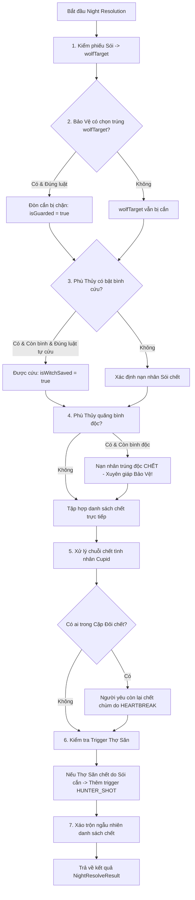

# ⚙️ Giai đoạn 2: Xử lý Logic Nghiệp vụ & Bất đồng bộ (Core Engine)

Tài liệu này tổng kết toàn bộ giải pháp kỹ thuật, mã nguồn đã triển khai và kết quả kiểm thử đơn vị cho **Giai đoạn 2**.

---

## 1. Engine tính toán kết quả Ban Đêm (`NightResolver`)

Mã nguồn: [`packages/shared/src/engine/night-resolver.ts`](file:///f:/luu%20vao%20day%20di/D%E1%BB%B1%20%C3%A1n%20c%C3%A1%20nh%C3%A2n/Werewolf/packages/shared/src/engine/night-resolver.ts)

### 1.1 Thứ tự giải quyết xung đột nghiệp vụ



### 1.2 Ràng buộc và Bảo mật đã hiện thực:
1. **Bảo Vệ:**
   - Không được bảo vệ 1 người 2 đêm liên tiếp (`lastProtectedId !== targetId`).
   - Có thể tự bảo vệ bản thân (cấu hình `bodyguardCanSelfProtect`).
   - Chỉ chặn đòn cắn của Sói, **không** chặn được bình độc của Phù Thủy.
2. **Phù Thủy:**
   - Kiểm tra ràng buộc tự cứu: `FIRST_NIGHT_ONLY` (mặc định), `ALWAYS`, hoặc `NEVER`.
   - Có thể dùng cả bình cứu và bình độc trong cùng một đêm nếu đủ điều kiện.
3. **Cặp đôi Cupid (Lovers):**
   - Vòng lặp liên hoàn: Nạn nhân chết kéo theo bạn tình chết với nguyên nhân `HEARTBREAK`.
4. **Thợ Săn (Hunter):**
   - Đưa vào hàng đợi `pendingTriggers: [{ kind: 'HUNTER_SHOT', playerId }]` để giải quyết vào buổi sáng, có thời gian đếm ngược riêng để Thợ săn chỉ định mục tiêu bắn trả thù.
5. **Data Masking:**
   - Danh sách `deaths[]` được **xáo trộn ngẫu nhiên (Fisher-Yates/Shuffle)** trước khi trả về, ngăn client dùng Network Tab để suy luận ai chết trước (bị sói cắn) hay ai chết sau (trúng độc).

---

## 2. Logic xử lý Timeout & Disconnect (Rớt mạng / Hết giờ)

Mã nguồn: [`packages/shared/src/engine/disconnect-handler.ts`](file:///f:/luu%20vao%20day%20di/D%E1%BB%B1%20%C3%A1n%20c%C3%A1%20nh%C3%A2n/Werewolf/packages/shared/src/engine/disconnect-handler.ts)

### 2.1 Ma trận xử lý Rớt mạng & Grace Period

| Trạng thái | Hành động của Server | Ảnh hưởng tới ván chơi |
|---|---|---|
| **Vừa mất kết nối** | Đặt `connection: 'DISCONNECTED'`, ghi lại `disconnectedAt = Date.now()` | Giữ nguyên ghế (seat), danh tính bí mật và quyền trong ván. Bật Grace timer (60s). |
| **Reconnect trong 60s** | Đặt `connection: 'ONLINE'`, hủy timer đếm ngược ngắt kết nối | Server lập tức gửi `state:snapshot` (đã mask qua `RoomProjector`) để client render lại ngay. |
| **Hết 60s không vào lại** | Đặt `connection: 'LEFT'` | - Nếu đang ở `LOBBY`: Giải phóng ghế cho người khác.<br>- Nếu đang chơi và còn sống: Người chơi bị xử chết do bỏ cuộc (`cause: 'LEFT'`). Nếu có người yêu, người yêu chết theo vì `HEARTBREAK`. Ván đấu tiếp tục không bị nghẽn. |

### 2.2 Fallback tự động khi hết giờ từng pha (Timeout Fallback)

| Phase | Fallback Action | Lý do thiết kế |
|---|---|---|
| `DAY_VOTING` / `DAY_REVOTE` | `DAY_VOTE { targetId: 'SKIP' }` | Tự động tính là phiếu trắng để chốt phiên bầu cử đúng giờ. |
| `DAY_JUDGMENT` | `DAY_JUDGE { verdict: 'INNOCENT' }` | Tránh việc người offline tự động kết tội người khác (nguyên tắc suy đoán vô tội). |
| `BODYGUARD_TURN` | Không bảo vệ ai | Hết giờ xem như Bảo Vệ không hành động. |
| `WEREWOLF_TURN` | `WOLF_VOTE { targetId: 'SKIP' }` | Nếu các con sói khác có chọn thì tính theo đa số; nếu toàn bộ sói ngủ quên thì đêm đó không ai bị cắn. |
| `WITCH_TURN` | `save: false, poisonTargetId: null` | Tuyệt đối **không** tự ý dùng bình độc/cứu của người chơi (tránh lãng phí). |
| `SEER_TURN` | Không soi ai | Hết giờ không chọn coi như bỏ qua lượt soi. |
| `CUPID_TURN` | Chọn ngẫu nhiên 2 người (`cupidTimeoutMode: 'RANDOM'`) | Đảm bảo tính năng Cặp đôi không bị hủy hoại nếu Cupid rớt mạng ở đêm đầu tiên. |

---

## 3. Cơ chế Countdown Timer đồng bộ chính xác NTP-style & Redis ZSET

Mã nguồn: [`packages/shared/src/engine/timer-sync.ts`](file:///f:/luu%20vao%20day%20di/D%E1%BB%B1%20%C3%A1n%20c%C3%A1%20nh%C3%A2n/Werewolf/packages/shared/src/engine/timer-sync.ts)

### 3.1 Giao thức đo độ lệch đồng hồ (NTP Clock Synchronization)
Thay vì gửi `remainingSeconds` giảm dần mỗi giây (gây lag network và không đồng đều giữa các máy), hệ thống sử dụng **Timestamp tuyệt đối (`phaseEndsAt`)**:

1. Client gửi `time:ping` chứa $t_0$ (thời gian client lúc gửi).
2. Server phản hồi `time:pong` chứa $t_0$ và `serverNow` ($t_1$).
3. Client nhận phản hồi tại thời điểm $t_2$.
4. **Công thức tính toán:**
   $$\text{Round-Trip Time (RTT)} = t_2 - t_0$$
   $$\text{Estimated Server Time at } t_2 = \text{serverNow} + \frac{\text{RTT}}{2}$$
   $$\text{Clock Offset} = \text{Estimated Server Time at } t_2 - t_2$$
   $$\text{Remaining Time (ms)} = \max(0, \text{phaseEndsAt} - (\text{clientNow} + \text{Clock Offset}))$$

### 3.2 Bộ điều phối Timer phân tán trên Redis (Redis ZSET Scheduler)
Trong hệ thống nhiều Node Backend (Horizontal Scaling):
- Server đăng ký timer vào Redis Sorted Set:
  - **Key:** `ww:timers`
  - **Score:** `phaseEndsAt` (Epoch ms)
  - **Member:** `${roomId}:${stateVersion}:${expectedPhase}`
- Background Worker định kỳ lấy các timer đã đến hạn bằng lệnh nguyên tử Lua script:
  ```lua
  local expired = redis.call('ZRANGEBYSCORE', 'ww:timers', 0, ARGV[1], 'LIMIT', 0, 50)
  if #expired > 0 then
    redis.call('ZREM', 'ww:timers', unpack(expired))
  end
  return expired
  ```
- **Ngăn chặn Race Condition:** Worker kiểm tra `stateVersion` của member với `stateVersion` hiện tại của phòng trong Redis. Nếu phòng đã chuyển pha trước đó (ví dụ tất cả đã vote xong sớm), timer hết hạn cũ sẽ tự động bị bỏ qua.

---

## 4. Kết quả Kiểm thử (Automated Unit Tests)

Đã chạy kiểm thử với `npx tsx --test`: **15/15 test cases PASSED**:
- ✅ Sói cắn thường -> nạn nhân chết.
- ✅ Sói cắn nhưng Bảo vệ che chở -> đòn cắn bị chặn hoàn toàn.
- ✅ Sói cắn nhưng Phù thủy cứu -> nạn nhân sống sót.
- ✅ Phù thủy quăng bình độc vào người được Bảo vệ che chắn -> độc xuyên giáp, nạn nhân chết.
- ✅ Cặp đôi Cupid: Nạn nhân chết kéo theo người yêu chết vì HEARTBREAK.
- ✅ Thợ săn bị Sói cắn -> Đưa vào danh sách pending trigger `HUNTER_SHOT`.
- ✅ Win condition: Sói bị diệt hết -> Dân làng thắng.
- ✅ Win condition: Sói >= Dân làng -> Sói thắng.
- ✅ Win condition: Cặp đôi khác phe sống sót cuối cùng -> Cặp Đôi (LOVERS) thắng.
- ✅ ClockSync: Tính toán offset và remaining ms chính xác.
- ✅ DisconnectHandler: Đánh dấu DISCONNECTED, khôi phục ONLINE khi Reconnect.
- ✅ Grace period hết hạn: Tự động loại người chơi, kéo theo người yêu chết theo.
- ✅ Fallback timeout: Tự động vote SKIP và giữ bình thuốc cho Phù thủy.
